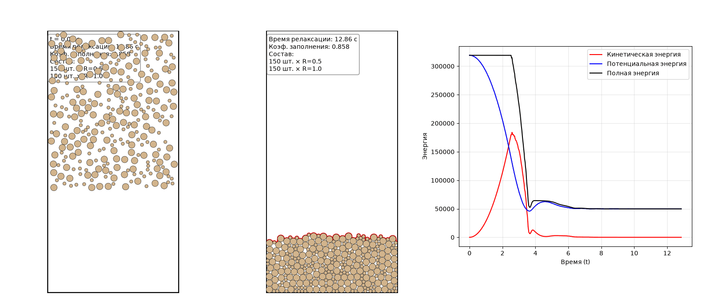
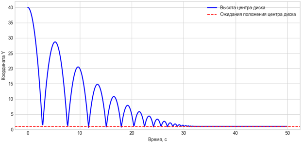
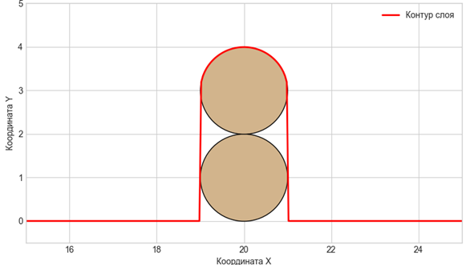
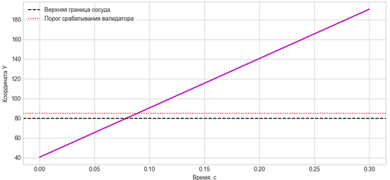
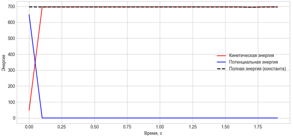
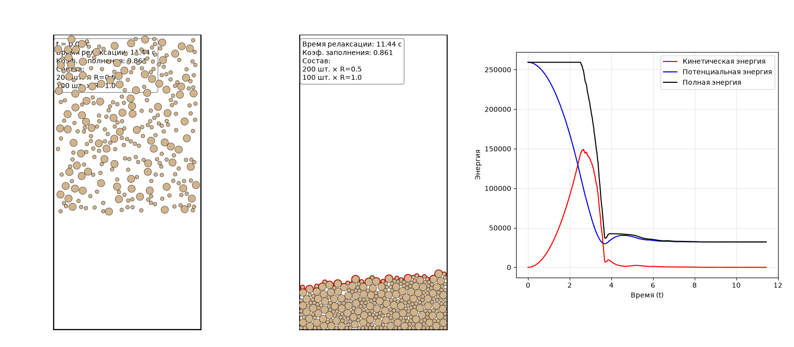
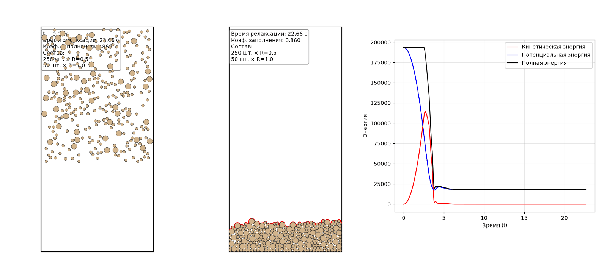
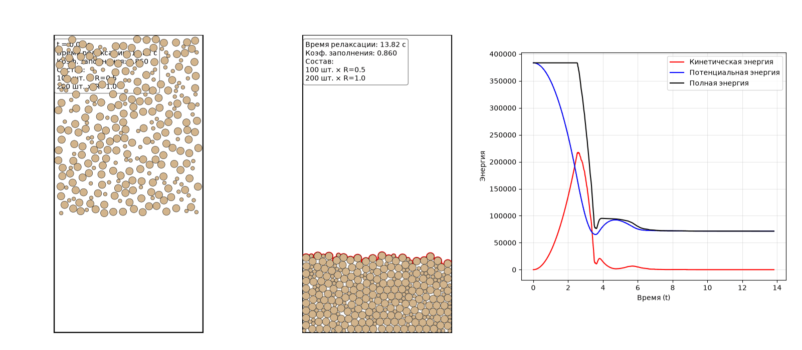
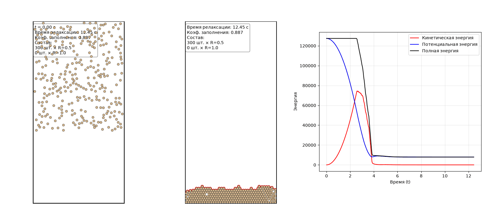
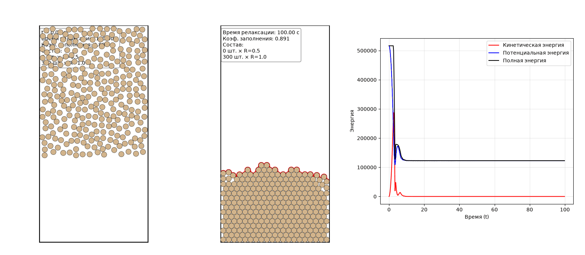

# Двумерная динамика гранулированных частиц: модель мягких дисков и интегратор Верле

Данный репозиторий содержит программную реализацию двумерной физической модели гранулированной среды, основанной на методе дискретных элементов (DEM). Модель имитирует процесс осаждения (засыпания) сыпучего материала в сосуд под действием силы тяжести, формирование упаковки и позволяет исследовать влияние состава бинарной смеси на плотность осадка.

## 📌 Содержание
1. [Демонстрация](#1-демонстрация)
2. [Физическая модель и численный метод](#2-физическая-модель-и-численный-метод)
3. [Валидация модели](#3-валидация-модели)
4. [Эксперименты с бинарными смесями](#4-эксперименты-с-бинарными-смесями)
5. [Установка и запуск](#5-установка-и-запуск)
6. [Параметры модели](#6-параметры-модели)

---

## 1. Демонстрация

Пример процесса осаждения бинарной смеси (150 мелких частиц + 150 крупных частиц). Видно, как частицы падают, сталкиваются, диссипируют энергию и образуют устойчивую случайную упаковку.


*(Здесь будет ваша гифка с общей анимацией падения)*

---

## 2. Физическая модель и численный метод

*   **Модель контакта:** Используются «мягкие диски» (Soft Disks). Допускается взаимное перекрытие частиц \(\delta\), при котором возникает сила отталкивания по модели Кельвина-Фойгта (пружина + вязкий демпфер).
*   **Силы трения:** Тангенциальное взаимодействие описывается вязким трением с ограничением по закону Кулона (сухое трение).
*   **Интегратор:** Для решения уравнений движения применяется **скоростная форма интегратора Верле** (Velocity-Verlet). Это симплектический метод, обеспечивающий высокую численную устойчивость и сохранение энергии при отсутствии диссипации.
*   **Критерий остановки:** Программа не работает фиксированное время. Она анализирует максимальную скорость частиц \(v_{max}\). Если она падает ниже \(0.1\), а её относительное изменение составляет менее \(0.1\%\) на протяжении 200 шагов, система считается остановившейся (время релаксации \(T_{rel}\)).
*   **Расчет коэффициента заполнения:** Используется строгий контурный метод. Алгоритм интегрирует площадь под верхней огибающей частиц \(y_{top}(x)\) и вычитает площадь взаимных перекрытий (линз) мягких дисков.

---

## 3. Валидация модели

Перед проведением основных вычислительных экспериментов была проведена серия тестов для доказательства физической и математической корректности кода.

### Тест 1. Свободное падение и затухание одной частицы
**Цель:** Проверка корректности работы силы тяжести, нормальной силы отталкивания от нижней стенки и нормального демпфера.
**Условия:** Одна частица радиуса \(R = 1.0\) отпускается с высоты \(y = L_y / 2\) без начальной скорости.
**Результат:** Частица падает на дно, совершает несколько затухающих отскоков и останавливается в положении равновесия, при котором её центр находится на высоте \(y \approx 1.0\). К моменту времени \(t \approx 15\) с кинетическая энергия полностью диссипирует.


*Рис. 1. Свободное падение и затухание одной частицы*

### Тест 2. Формирование контура и расчет коэффициента заполнения
**Цель:** Проверка корректности парного взаимодействия частиц, точности формулы площади пересечения (линзы) и алгоритма интегрирования верхнего контура слоя.
**Условия:** Две частицы радиуса \(R = 1.0\) отпускаются с разной высоты друг над другом.
**Результат:** Частицы ложатся друг на друга, образуя устойчивую стопку. Алгоритм корректно находит верхнюю огибающую, а значение коэффициента заполнения \(\phi\) для двух дисков составило \(0.832\), что подтверждает отсутствие ошибок в геометрическом расчете упаковки.


*Рис. 2. Проверка расчёта коэффициента заполнения*

### Тест 3. Стресс-тест граничных условий
**Цель:** Проверка работы модуля валидации на предмет отлова аномальных численных выбросов.
**Условия:** Одной частице задается нефизично высокая скорость \(v = 500\) м/с, направленная вверх, при отключенной гравитации.
**Результат:** При пересечении контрольного порога срабатывает валидатор, фиксируя ошибку «Вылет за верхнюю границу сосуда». Тест показал, что программа защищена от нефизичного поведения системы.


*Рис. 3. Проверка граничных условий*

### Тест 4. Сохранение энергии интегратором Верле
**Цель:** Проверка отсутствия численной диссипации (искусственной потери энергии) в скорость-форме интегратора Верле.
**Условия:** Система из 10 частиц, гравитация, трение и вязкость отключены. Частицам заданы случайные начальные скорости.
**Результат:** Кинетическая и потенциальная энергии постоянно переходят друг в друга, однако полная энергия остается практически горизонтальной. Дрейф энергии составил менее \(0.05\%\), что свидетельствует о высокой точности выбранного шага по времени.


*Рис. 4. Сохранение энергии интегратором Верле*

---

## 4. Эксперименты с бинарными смесями

Во всех экспериментах общее число частиц \(N = 300\). Радиус мелких \(R_1 = 0.50\), крупных \(R_2 = 1.00\). Исследуется доля мелких частиц \(x = N_1 / N\).

### 4.1. Сводная таблица результатов

| № | Состав (Мелкие / Крупные) | Доля \(x\) | Время \(T_{rel}\), с | Коэф. \(\phi\) |
|---|---|---|---|---|
| 1 | 150 / 150 | 0.50 | 12.86 | 0.858 |
| 2 | 200 / 100 | 0.67 | 11.44 | 0.861 |
| 3 | 250 / 50  | 0.83 | 22.66 | 0.860 |
| 4 | 100 / 200 | 0.33 | 13.82 | 0.860 |
| 5 | 50 / 250  | 0.17 | 24.23 | 0.863 |
| 6 | 300 / 0   | 1.00 | 12.45 | 0.887 |
| 7 | 0 / 300   | 0.00 | 100.0 | 0.891 |

### 4.2. Визуализация экспериментов

**Смесь 150 / 150 (x = 0.50)**

*(Гифка: Смесь 150/150)*

**Смесь 200 / 100 (x = 0.67)**

*(Гифка: Смесь 200/100)*

**Смесь 250 / 50 (x = 0.83)**

*(Гифка: Смесь 250/50)*

**Смесь 100 / 200 (x = 0.33)**

*(Гифка: Смесь 100/200)*

**Смесь 50 / 250 (x = 0.17)**

*(Гифка: Смесь 50/250)*

**Только мелкие (300 / 0, x = 1.0)**

*(Гифка: Только мелкие)*

**Только крупные (0 / 300, x = 0.0)**

*(Гифка: Только крупные)*

### 4.3. Основные выводы
1. **Максимум плотности:** Вопреки классической теории заполнения пор, максимальный коэффициент заполнения достигается в монодисперсных системах (\(\phi \approx 0.887 - 0.891\)) благодаря стремлению одинаковых дисков к гексагональной кристаллизации.
2. **Геометрическая фрустрация:** В бинарных смесях \(\phi\) падает до \(\approx 0.86\). Поскольку соотношение радиусов равно 2, мелкие частицы физически не могут провалиться в пустоты между крупными. Они действуют как «клинья», раздвигая крупные частицы и препятствуя формированию плотного каркаса.
3. **Время релаксации:** Монодисперсная система крупных частиц (\(R=1.0\)) релаксирует дольше всех из-за высокой инерции и склонности к образованию устойчивых арок (сводов). Добавление мелких частиц дестабилизирует эти арки и ускоряет успокоение системы.

---

## 5. Установка и запуск

Вам потребуется Python версии 3.8 или выше.

1. Склонируйте репозиторий:
   ```bash
   git clone https://github.com/yourusername/2d-granular-dynamics.git
   cd 2d-granular-dynamics
